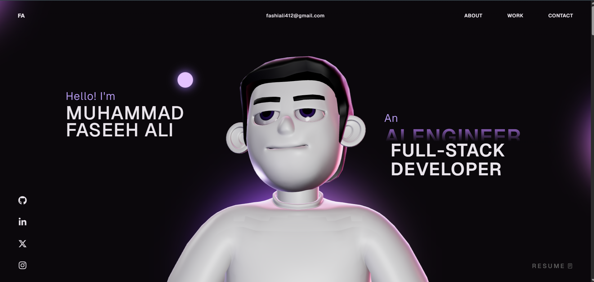

# Muhammad Faseeh Ali — Portfolio

An interactive portfolio for **Muhammad Faseeh Ali**, an AI Engineer and Full-Stack Developer based in Lahore, Pakistan.

## Landing page




## About

The site presents selected projects, skills, career experience, a résumé, and contact links. It also includes an interactive 3D character and a small chess page.

## Tech stack

- React and TypeScript
- Vite
- Three.js and WebGL
- GSAP and Lenis
- Vercel Functions for the AI chat endpoint

## Run locally

```bash
npm install
npm run dev
```

Create a `.env` file with `GROQ_API_KEY=your_key` if you want the AI chat endpoint to work locally. Never commit the real API key.

## Build

```bash
npm run build
npm run preview
```

## Project files

| File or folder | Purpose |
| --- | --- |
| `src/config.ts` | Profile, social links, experience, skills, and project content |
| `src/components/` | Portfolio sections, navigation, reusable UI, and styles |
| `src/components/Character/` | Three.js scene and character animation code |
| `src/pages/` | Work gallery and chess/chat page |
| `src/utils/` | Text and chess engine utilities |
| `public/images/` | Project artwork and technology images |
| `public/models/` | 3D character assets |
| `public/Faseeh-Ali-CV.pdf` | Résumé linked from the portfolio |
| `api/chat.js` | Server-side Groq chat endpoint; reads `GROQ_API_KEY` |
| `index.html` | Page metadata and app mount point |
| `vite.config.ts` | Vite build and bundle configuration |
| `vercel.json` | Vercel routes and response headers |
| `LICENSE` | MIT license file retained from the original portfolio template |

## Contact

- Email: [fashiali412@gmail.com](mailto:fashiali412@gmail.com)
- GitHub: [Faseeh-Ops](https://github.com/Faseeh-Ops)
- Location: Lahore, Pakistan
